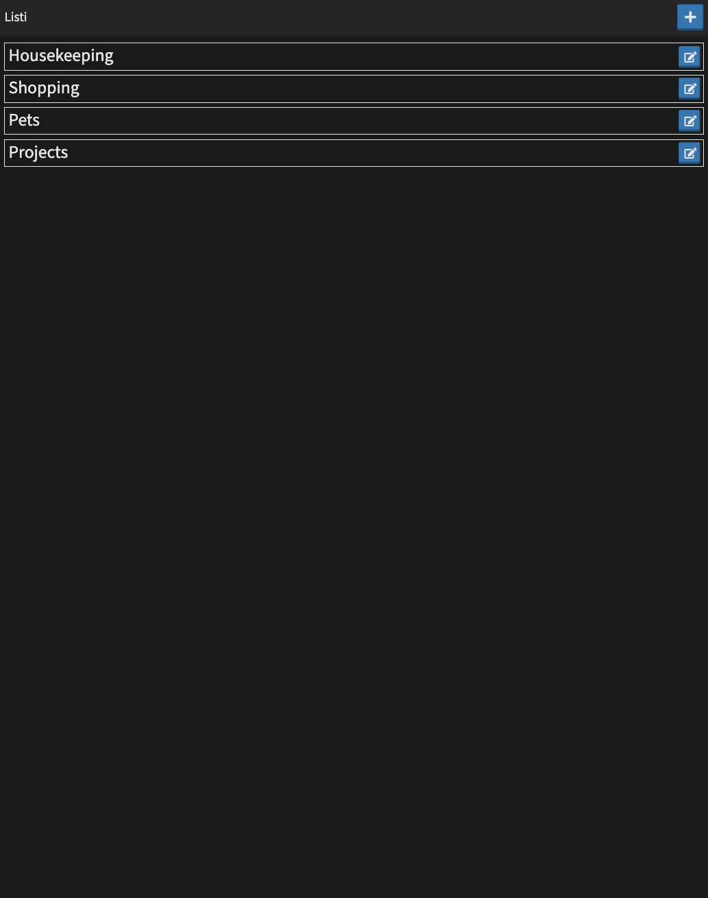
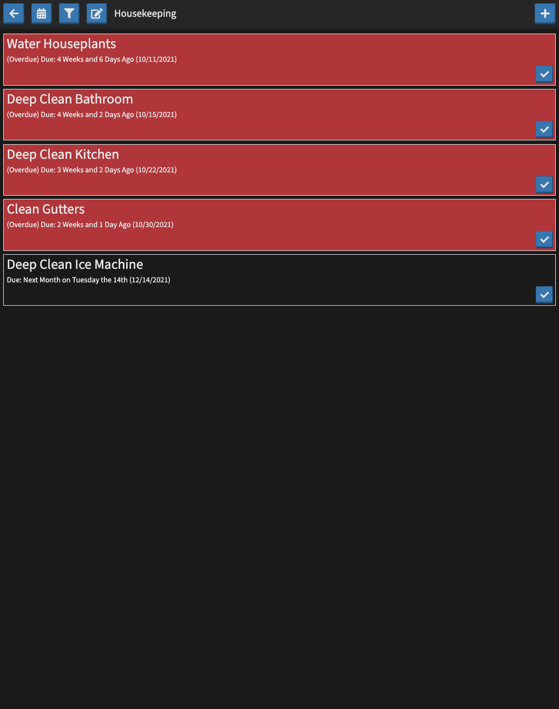

# listi

Like normal "lists", but better (Plus it uses "i" to pluralize)

## Screenshots





## Items

Each listi item is both a list and an item. There are 2 major types of listi item:

Static:

```js
{
	id: nanoid,
	name: String,

	description: ?String,
	metadata: ?Object,

	createdDate: Date,
	lastUpdatedDate: Date,

	tags: ?Array[String],
	template: Listi.item{},
	maxFilterDepth: Number||1,
	filter: ?[
		{
			[itemKey]: ?{
				has: ?[String|RegExp],
				not: ?[String|RegExp],
				exists: ?Boolean,
			},
			[due||createdDate||lastUpdatedDate]: ?{
				before: ?Date,
				after: ?Date,
				exists: ?Boolean,
			},
			itemIds: ?[nanoid]
		},
	],
	sort: ?[{ property: String, order: 'asc|desc' }]
}
```

Completable:

```js
{
	...static
	due: ?Date,
	onComplete: ?Array[Array['addTag', { tag: 'complete' }], ...],
}
```

IDEA: Merge description into metadata?

IDEA: replace onComplete with more generic "action buttons" feature that allows for all onComplete behavior to be assigned to configurable icon buttons visible on the item cards

Completable listi items support a few special `onComplete` actions, you can configure any number of these. These actions will be preformed when either; a user completes the specific item, or completes all its completable child items:

- `complete, { ?id, ?ids, ?children }`: complete another listi item
- `completeChildren`: complete all completable child items
- `delete, { ?id, ?ids }`: delete a listi item (targets self if id is omitted)
- `tag, { action: add|remove, ?id, ?ids, ?tag, ?tags }`: add a tag (targets self if id is omitted)
- `reschedule, {}`:
  - Next in absolute pattern: Every X day/week/month/year(s) || array of dates
  - Relative modification: (Completion Date|Last Due Date) + X day/week/month/year(s)

The default onComplete value is `[['addTag', { tag: 'complete' }]]`

## Filters

IDEA: filters could be a feature of items and replace the concept of children (the default view then just becomes an item)

Filters are a saveable set of criteria for curating the listi items view.

```js
{
	id: nanoid,
	name: String,
	filter: ?[
		{
			[itemKey]: ?{
				has: ?[String|RegExp],
				not: ?[String|RegExp],
			},
			[due||createdDate||lastUpdatedDate]: ?{
				before: ?Date,
				after: ?Date,
				exists: ?Boolean,
			},
			itemIds: ?[nanoid]
		},
	],
	sort: ?[{ property: String, order: 'asc|desc' }]
	quickFilters: {
		[name]: {
			filter: ?[]
			sort: ?[]
		}
	}
}
```

---

- Custom name
- Sort by: Due date (Past due X days / Due today / Due in X days), Order added
- Filter by: Due date (Today / This week / This month), Tag(s)


## Views

- Listi (lists) | Add a new list, open a saved list, or edit a saved list
  - Create/Edit List | Delete, Edit: name
  - List | Delete, Add a new item, edit an item, complete item, edit filter, edit sort, calendar view
    - Create/Edit List Item | Edit: summary, description, tags, due date, recurring, linked list
    - Edit filter | (includes|excludes) tags, due date (optional range w/ easy presets eg: Today / This week / This month), (summary, description, tags) (includes|excludes) user input
    - Calendar | See/create/edit items from a calendar interface

## Use Cases

- shopping list
- housekeeping list
- project/todo list
- recurring maintenance (steps/materials/tools)
- inventory list (games, seeds)
- hybrid lists (mixing contents from multiple lists and types of items)

```json
{
	"name": "",
	"description": "",
	"tags": [""],
	"items": [],
	"template": {},
	"due": null,
	"onComplete": []
}
```

---

- List

  - Name
  - Default list item options
  - Sort by due date: Past due X days / Due today / Due in X days / No due date
  - Filter
    - Contains text: Summary/Description/Tags :: Includes/Excludes X (maybe suggest tags that exist in the list?)
    - Due Date: Today, This week/month/year
    - Include unscheduled: true/false

- List item
  - Summary
  - Description
  - Tags
  - Due date
  - Recurring
    - Absolute: Every X day/week/month/year(s) @12:00AM
  - Overdue markings (include stacking missed items)
  - Complete Action
    - Add/Remove Tag X
    - Delete list item
    - Reschedule
      - Relative (Completion Date/Last Due Date): X day/week/month/year(s) after I last completed it

## TODO

- add a top-level calendar that shows items from all lists (with ability to toggle them)
- add top-level list view to see aggregate of all lists (with ability to toggle them)
- tag colors?
- everything as tags? (due dates, etc.)
- multiselect/batch operations (complete, delete)
- add saved sort & filter
- priority
- NEW FILTERS IDEA
  - filters contain a set of criteria for curating the list view
  - these new filters will consume the previously planned filter and sort feature
